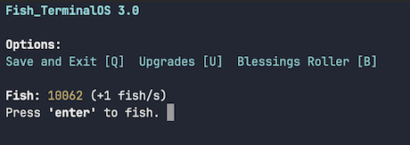
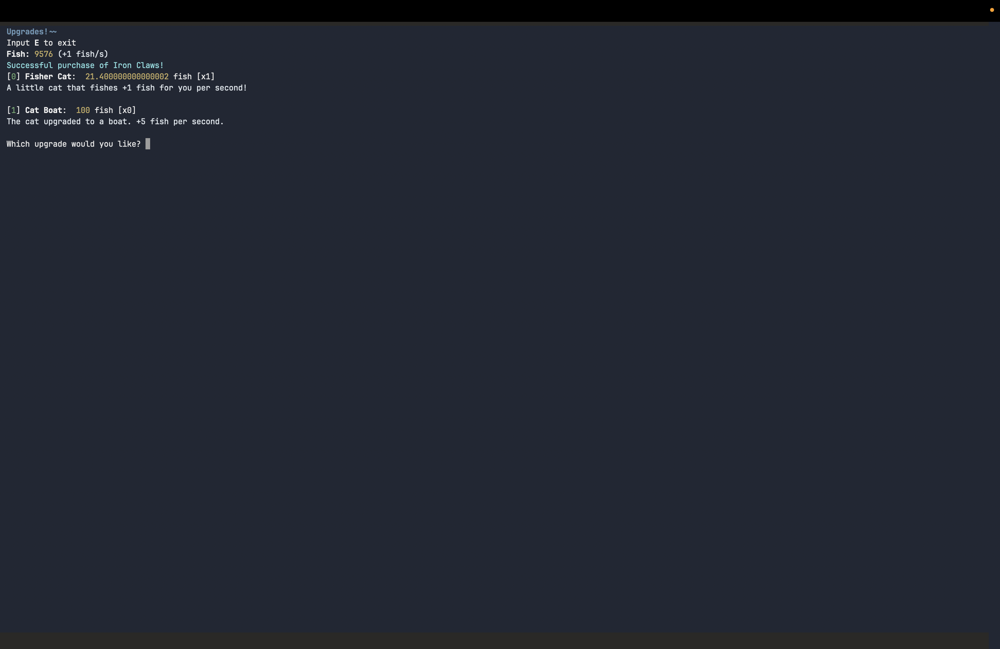
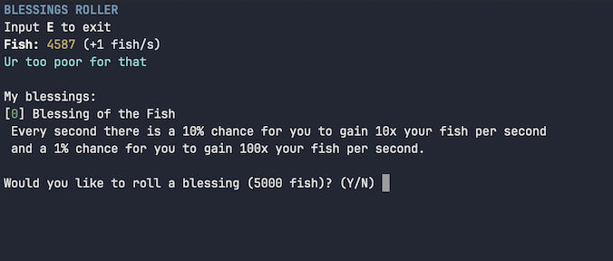
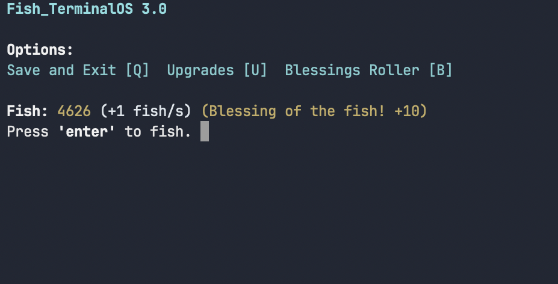
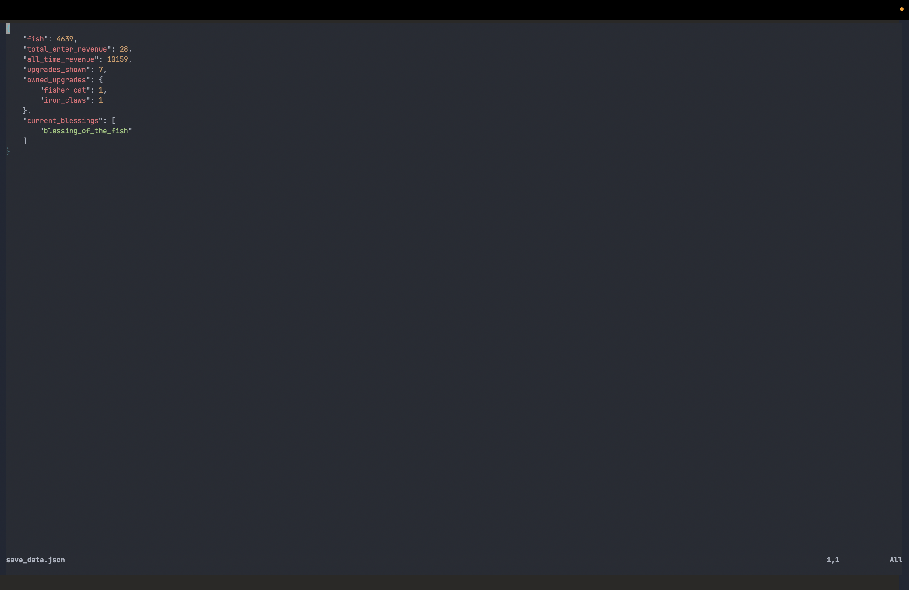

# Python Mini Incremental Game

This is a Mini Incremental Game based on fishing to warm up my python skills! Includes basic features such as saving, upgrades, etc. 

## Features
**Main menu** - manually fish for, well, fish, in this menu!


**Upgrades** - upgrades you can buy to increase your fish production! You unlock more as you progress.
There are 9 upgrades currently in the game as shown here:
```python
available_upgrades = {
    "fisher_cat": Upgrade("Fisher Cat", "fisher_cat", "A little cat that fishes +1 fish for you per second!" ,20, 1.07, AdditivePerSecondEffect(1)),
    "cat_boat": Upgrade("Cat Boat", "cat_boat", "The cat upgraded to a boat. +5 fish per second.", 100, 1.07, AdditivePerSecondEffect(5)),
    "iron_claws": Upgrade("Iron Claws", "iron_claws", "Sharp claws. One-time upgrade. +1 fish per enter hit.", 500, 1, AdditivePerEnterEffect(1), True),
    "fish_farm": Upgrade("Fish Farm", "fish_farm", "Woah a whole fish farm?? +20 fish per second.", 500, 1.07, AdditivePerSecondEffect(20)),
    "fish_factory": Upgrade("Fish Factory", "fish_factory", "This fish factory mass produces +100 fish every second.", 1000, 1.07, AdditivePerSecondEffect(100)),
    "golden_claws": Upgrade("Golden Claws", "golden_claws", "Even sharper claws. One-time upgrade. +1 fish per enter hit.", 4000, 1, AdditivePerEnterEffect(1), True),
    "blessed_halo": Upgrade("Blessed Halo", "blessed_halo", "This holy item provides you with an extra blessing slot.", 6000, 1, AddBlessingSlotEffect(1), True),
    "milk": Upgrade("Milk", "milk", "This milk tastes strange... at least it makes your fish generation 100% faster!", 10000, 1, AdditiveMultiplicativePerSecondEffect(1), True),
    "fish_planet": Upgrade("Fish Planet", "fish_planet", "A whole planet of fish! Produces +500 fish every second. ", 10000, 1.07, AdditivePerEnterEffect(1)),
}
```


**Blessings** - special bonuses that can be rolled in the "Blessings Roller". These can be "blessings" or "curses", giving positive/negative effects depending on what you roll!
There are currently 5 blessings as shown:
```python
self.available_blessings = [
    BlessingOfTheFish("Blessing of the Fish", "blessing_of_the_fish", " Every second there is a 10% chance for you to gain 10x your fish per second \n and a 1% chance for you to gain 100x your fish per second.", 4),
    CurseOfTheFish("Curse of the Fish", "curse_of_the_fish", " Every second there is a 10% chance for you to not gain any fish.", 4, True),
    PoseidonsBlessing("Poseidon's Blessing", "poseidons_blessing", " Your fish per second is scaled by 1.5x multiplied by number of digits of revenue from fish you *hand fished*.", 2),
    MrBlessing("Mr. Blessing", "mr_blessing", " Gain 2 blessing slots. Only one of this blessing can exist at the same time.", 1, False, True),
    BartonCurse("Barton's Curse", "bartoncurse", " Barton comes out of no where and takes 5% of your fish every 10 seconds.  ", 2, True, False)
]
```


Here is an example of a blessing (blessing of the fish) in action:


**Saving** - I managed to implement a fully working saving system with json!

